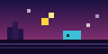
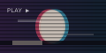
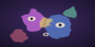
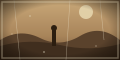
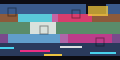
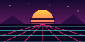
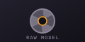

<!-- OLD MODEL IMAGES — style thumbnails below are repository assets, not generated-output samples. -->

  

<h1 align="center">OLD MODEL IMAGES</h1>

  <strong>A local-first retro AI image studio for vintage photography, pixel art, VHS, synthwave, and early-AI aesthetics.</strong>
   
  Generate images on your own Windows PC with Stable Diffusion 1.5 — without a cloud inference account.

  
  
  
  
  
  

  <a href="#what-it-does">What it does</a> ·
  <a href="#style-gallery">Style gallery</a> ·
  <a href="#quick-start-windows">Quick start</a> ·
  <a href="#how-it-works">How it works</a> ·
  <a href="#security-and-content-safety">Security & safety</a> ·
  <a href="#tests">Tests</a>

---

## What it does

**Old Model Images** (repository: **Old-Image-Model**) is a local web-based text-to-image studio for intentionally nostalgic visual styles — from chunky 8-bit sprites and PlayStation-era low-poly scenes to VHS captures, faded Polaroids, retro anime, glitch art, and the strange look of early generative AI.

A lightweight Flask server serves a custom CRT-inspired browser interface. The generation engine uses **Stable Diffusion 1.5 / DreamShaper 8**, optional style LoRAs, a required second high-resolution pass, and optional tiled Real-ESRGAN upscaling. Generated images and the gallery index are stored locally in the project's **outputs/** directory.

The codebase is especially tuned for constrained Windows hardware such as a laptop with an **NVIDIA RTX 2050 4 GB GPU and 8 GB system RAM**. Other systems may work, but speed, memory use, and compatibility will vary.

> **Local inference, with a download step:** the application is designed to generate images on your own machine. Initial setup must download model checkpoints, safety weights, upscalers, and available LoRAs from their configured model repositories. Once those files are present, image inference runs locally; this is not a cloud-hosted image-generation service.

## Style gallery

These are the **actual SVG style thumbnails shipped with the UI**. They illustrate the selectable art directions; they are not example outputs generated by the model.

<table>
  <tr>
    <td align="center"> <strong>8-Bit Pixel</strong> NES / Game Boy era</td>
    <td align="center"> <strong>16-Bit Pixel</strong> SNES / Genesis era</td>
    <td align="center"> <strong>Low Poly PS1</strong> Faceted retro 3D</td>
    <td align="center"> <strong>CRT / VHS</strong> Scanlines & tape grain</td>
  </tr>
  <tr>
    <td align="center"> <strong>Early AI</strong> DeepDream-era surrealism</td>
    <td align="center"> <strong>Vintage Photo</strong> Sepia & silver-gelatin</td>
    <td align="center"> <strong>Faded Polaroid</strong> 1970s instant film</td>
    <td align="center"> <strong>Glitch Art</strong> Digital decay</td>
  </tr>
  <tr>
    <td align="center"> <strong>Retro Anime</strong> 1980s–1990s cel style</td>
    <td align="center"> <strong>Synthwave</strong> Neon grids & chrome</td>
    <td align="center"> <strong>No Style</strong> Clean base model output</td>
    <td align="center"> <strong>Old Model Images</strong> Local-first image studio</td>
  </tr>
</table>

The repository intentionally ignores generated output files, so this README does not pretend that the thumbnails above are real generated samples. After testing the app, add a small set of real, clearly labelled sample images to improve the project showcase.

## Highlights

- **Eleven data-driven styles:** styles and prompt templates are defined in **styles/styles.json**; adding a style usually does not require changing Python engine code.
- **LoRA with fallback prompts:** if a configured style LoRA is unavailable, the engine can use the style's engineered prompt template instead.
- **Multiple aspect ratios:** square, landscape, portrait, widescreen, and tall formats.
- **Choice of samplers:** seven sampler configurations are exposed in the interface.
- **Seed control:** use a fixed seed to help reproduce a composition with the same model, prompt, and settings.
- **Mandatory 2× high-resolution pass:** choose img2img hires-fix or the Real-ESRGAN x2 path.
- **Optional Ultra upscaling:** tiled Real-ESRGAN x4 with memory-aware fallbacks and a maximum-pixel guard.
- **Three performance profiles:** Safe, Balanced, and Fast — with Safe intended for low-VRAM GPUs.
- **Persistent local gallery:** generated PNG files and a gallery index are stored under **outputs/**.
- **Progress and health indicators:** the UI polls a job endpoint and can show generation progress, GPU/RAM/model status, and actionable errors.
- **One generation at a time:** a process-level lock prevents overlapping jobs from exhausting GPU memory.
- **Layered content-safety checks:** multilingual prompt filtering, forced negative terms, and an optional image-output safety scan.
- **Local API protections:** localhost-only request checks, Host allow-list, per-start session token, signed image URLs, headers, input validation, and rate limits.
- **Low-overhead front end:** Flask, vanilla JavaScript, and CSS — no Node build step needed.

## How it works

~~~mermaid
flowchart TD
    A["Browser UI templates/index.html static/js/app.js"] --> B["Local Flask server app.py"]
    B --> C["Request validation session token / rate limit / prompt safety"]
    C --> D["Single generation job"]
    D --> E["OldModelGenerator generator.py"]
    E --> F["DreamShaper 8 Stable Diffusion 1.5"]
    F --> G["Base image"]
    G --> H["2× hires pass"]
    H --> I{"Ultra enabled?"}
    I -- "Yes" --> J["Tiled Real-ESRGAN upscale"]
    I -- "No" --> K["Post-processing / safety scan"]
    J --> K
    K --> L["PNG + local gallery index"]
    L --> M["Signed local image URL"]
~~~

### Main components

| Path | Role |
| --- | --- |
| **app.py** | Flask routes, JSON API, request validation, job tracking, local security gates, and error responses |
| **generator.py** | Diffusers pipeline, sampler configuration, prompt assembly, LoRA lifecycle, hires pass, tiled Real-ESRGAN, post-effects, and gallery storage |
| **safety.py** | Prompt normalization/filtering and category-based block messages |
| **download_models.py** | Resumable downloads of the base checkpoint, safety-checker files, upscaler weights, and configured LoRAs |
| **config.json** | Model IDs, folders, server port, security limits, performance defaults, and safety settings |
| **styles/styles.json** | Style names, thumbnails, prompts, optional LoRA metadata, recommended CFG/steps, and post-effects |
| **static/** | UI styles, JavaScript, logo, and style thumbnails |
| **templates/index.html** | Main image-generation page |
| **setup.bat** | Creates a virtual environment, installs dependencies, verifies CUDA, and downloads model files |
| **run.bat** | Starts the local server with memory/cache environment variables |
| **tests/** | Safety, API/security, generation, and model-loading tests |
| **.github/workflows/ci.yml** | GitHub Actions workflow for the test suites |

## System requirements

### Tested design target

- Windows 11, 64-bit
- Python **3.10, 3.11, or 3.12** (64-bit)
- NVIDIA GPU with CUDA support; the design target is **4 GB VRAM**
- About **8 GB system RAM** (more is strongly recommended for multitasking)
- Roughly **8–10 GB of free disk space** for dependencies and model files, with extra space recommended for outputs and caches
- Internet access for the initial dependency/model downloads

CPU-only or non-NVIDIA use is **not the intended primary setup**. Some test suites can run in CPU-only CI, but that does not imply practical CPU-only generation speed.

## Quick start (Windows)

The simplest path is to use the included setup script.

### 1. Install Python

Install 64-bit Python 3.10, 3.11, or 3.12 from [python.org](https://www.python.org/downloads/windows/). During installation, enable **Add Python to PATH**.

### 2. Download or clone the repository

~~~powershell
git clone https://github.com/computerengineer1/Old-Image-Model.git
cd Old-Image-Model
~~~

Or download the repository ZIP from GitHub and extract it to a folder. Paths containing spaces are supported by the batch scripts.

### 3. Run one-time setup

Double-click **setup.bat**, or run it from PowerShell:

~~~powershell
./setup.bat
~~~

The script creates **.venv**, installs the pinned Python/PyTorch stack, checks CUDA availability, and starts **download_models.py**. The downloads are large (roughly several gigabytes); a stable connection and sufficient free disk space are needed. Optional xformers installation may fail; the project is designed to fall back to PyTorch SDPA when available.

### 4. Start the app

Double-click **run.bat**, or:

~~~powershell
./.venv/Scripts/python.exe app.py
~~~

The browser should open at **http://127.0.0.1:8756**. If it does not, open that address manually.

### 5. Generate an image

1. Write a descriptive prompt.
2. Choose a style and aspect ratio.
3. Adjust steps, CFG scale, sampler, and seed under Advanced settings if needed.
4. Choose Standard or Ultra resolution.
5. Press **Generate** and watch the progress state.
6. Open the resulting image or download it from the local gallery.

The first generation may take around **1–2 minutes** on the target laptop while the model is loaded. Later generations in the same session are faster, but high resolutions and upscaling can take several minutes. Actual timings vary with hardware, driver, ratio, settings, and background applications.

To stop the server, close the console window or press Ctrl+C in the terminal.

## Models, styles, and resolution

### Base model and dependencies

- **Base checkpoint:** **Lykon/dreamshaper-8** (Stable Diffusion 1.5 family; configured for a local diffusers layout).
- **Upscaler:** Real-ESRGAN weights from the configured **ai-forever/Real-ESRGAN** repository.
- **Optional LoRA:** PixelArtRedmond 1.5V for the pixel-art styles; other styles can use prompt templates and optional post-processing.
- **Pipeline:** Hugging Face Diffusers + PyTorch, with safetensors-oriented checkpoint loading.

Model weights are **not committed to this Git repository**. The downloader stores them in the folders defined by **config.json** and the style catalog.

### Included styles

| Style key | Visual direction | Enhancement |
| --- | --- | --- |
| **pixel_8bit** | Chunky NES/Game Boy pixels | Pixel-art LoRA when available; otherwise prompt fallback |
| **pixel_16bit** | SNES/Genesis-style sprite art | Same LoRA family at a lower weight when present |
| **low_poly** | PS1-era faceted 3D | Prompt-engineered |
| **crt_vhs** | Scanlines, RGB split, tape grain | Prompt + post-processing |
| **early_ai** | DeepDream / early GAN surrealism | Prompt-engineered |
| **vintage_photo** | Antique sepia / silver-gelatin photography | Prompt-engineered |
| **polaroid** | Faded instant-film look | Prompt + Polaroid-frame post-processing |
| **glitch_art** | Digital corruption and chromatic split | Prompt-engineered |
| **retro_anime** | 1980s–1990s cel-inspired anime | Prompt-engineered |
| **synthwave** | Neon grids, chrome, magenta sunsets | Prompt-engineered |
| **no_style** | Clean base-model direction | No style LoRA required |

A style card can show whether a LoRA is actually present. Missing LoRA files are expected to use that style's fallback prompt where configured; they should not be assumed to have the same characteristics as a trained LoRA.

### Supported ratios

The base model pass is followed by a 2× hires stage. Exact final dimensions are handled by the ratio table in **generator.py**.

| Ratio | Base pass | Standard final (2×) |
| --- | ---: | ---: |
| 1:1 | 512 × 512 | 1024 × 1024 |
| 4:3 | 680 × 512 | 1360 × 1024 |
| 3:4 | 512 × 680 | 1024 × 1360 |
| 16:9 | 912 × 512 | 1824 × 1024 |
| 9:16 | 512 × 912 | 1024 × 1824 |
| 3:2 | 768 × 512 | 1536 × 1024 |
| 2:3 | 512 × 768 | 1024 × 1536 |

Ultra upscaling may be reduced to a smaller factor when the output would exceed the configured megapixel safety guard. The application should report that fallback in its result notes.

### Performance profiles

- **Safe:** sequential CPU offload; recommended for 4 GB VRAM and limited system RAM.
- **Balanced:** model-level CPU offload; potentially faster, depending on available memory.
- **Fast:** keeps more components on the GPU; can exhaust 4 GB VRAM, especially for wide/tall images or Ultra upscaling.

If generation runs out of memory, return to Safe mode, turn off Ultra, use a lighter aspect ratio, lower the step count, and close GPU-heavy applications.

## Local API overview

All **/api/** routes require the per-start **X-OMI-Token** delivered with the main page. Image-output links require the **?tk=** token signature.

| Endpoint | Method | Purpose |
| --- | --- | --- |
| **/** | GET | Serve the web UI |
| **/api/styles** | GET | Return styles, aspect ratios, samplers, and defaults |
| **/api/generate** | POST | Validate and submit a generation job |
| **/api/progress/<job_id>** | GET | Poll job status, progress, result, or friendly error |
| **/api/gallery** | GET | List existing outputs, newest first |
| **/api/gallery/delete** | POST | Delete a selected gallery PNG |
| **/api/settings** | POST | Update runtime performance, hires, Ultra, and output-scan settings |
| **/api/health** | GET | Report GPU/RAM/model/job health |
| **/outputs/<filename>** | GET | Serve a signed result image; add **download=1** to download |

API errors use friendly JSON messages and hints. Detailed Python tracebacks are written to **logs/app.log** rather than returned to the browser.

## Security and content safety

This application is intended to run on the user's own computer, not as a public multi-user server. The default configuration binds to **127.0.0.1**, disallows LAN access, and checks the request host and per-start API token. Additional controls include Content Security Policy and response headers, request-size limits, API rate limits, input validation, signed output URLs, a single-generation lock, and output-path sanitization.

The prompt safety pipeline includes normalization for common evasion patterns and multiple languages, always-merged negative prompt terms, and a CLIP-based output-image check when configured and its weights are available. The output-image scan can be disabled in Advanced settings, which changes the protection state.

**No automated filter is perfect.** Prompt filtering may block innocent terms or miss unsafe requests, while the image classifier may produce false positives or false negatives. Safety badges describe the current configured layers; they are not a guarantee that every output is safe. Do not expose the local server to a LAN or the public internet unless you have independently designed and audited an appropriate remote threat model.

## Troubleshooting

**The first generation appears stuck or slow**  
Loading the checkpoint and initializing CUDA can take a while. Check the health badges and **logs/app.log**; confirm that setup downloaded the checkpoint and that the laptop is plugged in.

**CUDA out-of-memory error**  
Choose Safe mode, disable Ultra, select 1:1 or 4:3, reduce steps, close GPU-heavy software, and retry. The engine contains OOM handling, but not every hardware/driver combination can avoid every memory failure.

**A model or LoRA file failed to download**  
The downloader is designed to resume and report file-level failures. Retry:

~~~powershell
./.venv/Scripts/python.exe download_models.py
~~~

Review **logs/download_report.txt**. A missing optional LoRA should use a prompt fallback where available; a missing required checkpoint or upscaler will limit the corresponding functionality.

**xformers failed to install**  
This is optional. With a compatible PyTorch build, the app is designed to fall back to PyTorch SDPA. Do not let pip silently upgrade the pinned torch version just to install an attention package.

**Port 8756 is already in use**  
Change **server.port** in **config.json** and restart the app.

**A style does not look as expected**  
Check the style badge to see whether a LoRA is loaded or a prompt fallback is in use. Add concrete subject, composition, lighting, and texture details to your prompt; try the recommended CFG and step values for the selected style.

## Tests

The repository contains four test suites and a GitHub Actions workflow:

~~~powershell
./.venv/Scripts/python.exe tests/test_safety.py
./.venv/Scripts/python.exe tests/test_app_smoke.py
./.venv/Scripts/python.exe tests/test_generation_cpu.py
./.venv/Scripts/python.exe tests/test_model_load_fix.py
~~~

- **test_safety.py** exercises prompt filtering, normalization, and multilingual cases.
- **test_app_smoke.py** checks routes, security gates, static assets, and the UI/API contract with a stub engine.
- **test_generation_cpu.py** exercises the generation path using a tiny test pipeline and can require network access to retrieve test assets plus the real upscaler weights for those checks.
- **test_model_load_fix.py** covers checkpoint-loading regressions.

CI is configured in **.github/workflows/ci.yml** to run on pushes to **main** and on pull requests. This documentation does not claim that the latest workflow run passed; see the repository's Actions tab for current results.

## Credits, model cards, and licensing

- **DreamShaper 8** — model card: [Lykon/dreamshaper-8](https://huggingface.co/Lykon/dreamshaper-8). Review the model's current license and usage terms.
- **Real-ESRGAN** — configured weights: [ai-forever/Real-ESRGAN](https://huggingface.co/ai-forever/Real-ESRGAN); review upstream license and attribution requirements.
- **PixelArtRedmond 1.5V** — optional style LoRA: [Hugging Face model repository](https://huggingface.co/artificialguybr/pixelartredmond-1-5v-pixel-art-loras-for-sd-1-5).
- **PyTorch, Diffusers, Transformers, Accelerate, PEFT, Flask, Pillow, and other dependencies** retain their own licenses.

Model weights and third-party assets are subject to their upstream terms. The repository does not currently include a root-level **LICENSE** file, so the license for this project's own source code is not clearly specified. Add an appropriate license before inviting broad reuse or redistribution.

Generated files are saved locally by default. Rights to a generated image can still depend on applicable law, model terms, and the content you create; review those requirements for your use case.

## Contributing

Improvements to documentation, accessibility, style templates, low-memory operation, test coverage, safety, and cross-hardware compatibility are welcome.

1. Open an issue explaining the problem or proposed improvement.
2. Create a focused branch.
3. Add tests or reproducible steps where possible.
4. Submit a pull request describing behavior changes, trade-offs, and any limitations.

Please avoid committing model weights, personal outputs, real secrets, or cache files. The **.gitignore** is intended to keep large runtime assets out of Git.

---

## ملخص عربي

**Old Model Images** هو استوديو محلي لتوليد الصور بالذكاء الاصطناعي بطابع قديم: صور فوتوغرافية عتيقة، بولارويد، VHS، فن 8-bit و16-bit، ورسوم Synthwave وRetro Anime. يستخدم Flask لواجهة المتصفح، وStable Diffusion 1.5/DreamShaper 8 لتوليد الصور محليًا، مع تحسين دقة اختياري عبر Real-ESRGAN.

البدء على Windows: ثبّت Python 3.10–3.12 بنسخة 64-bit، شغّل **setup.bat** لتنزيل المتطلبات والنماذج، ثم **run.bat** وافتح **http://127.0.0.1:8756**. تحتاج عملية الإعداد إلى الإنترنت ومساحة تخزين كبيرة لتنزيل النماذج، رغم أن التوليد نفسه يعمل محليًا بعد تجهيزها.

استُهدف المشروع للأجهزة ذات ذاكرة VRAM بسعة 4 GB وذاكرة نظام 8 GB؛ لذلك يُنصح بوضع Safe عند مواجهة أخطاء الذاكرة. فلاتر المحتوى تقلل بعض المخاطر لكنها ليست ضمانًا كاملًا، ولا ينبغي كشف خادم localhost للإنترنت العام.
